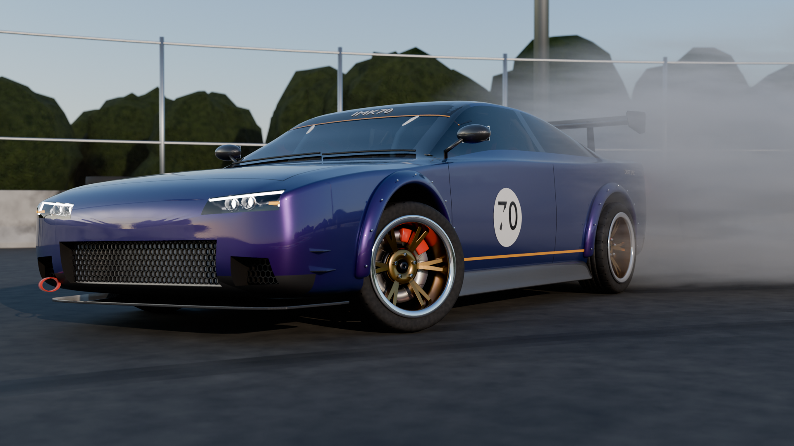
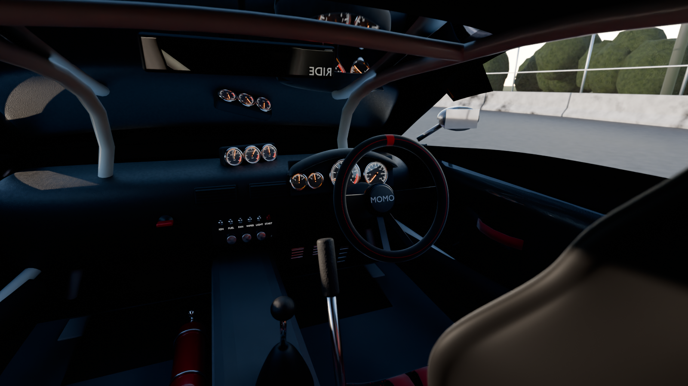
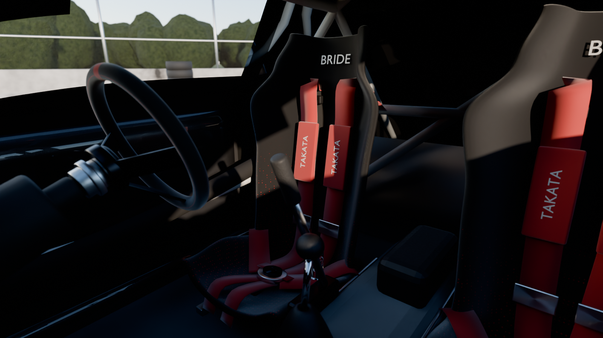
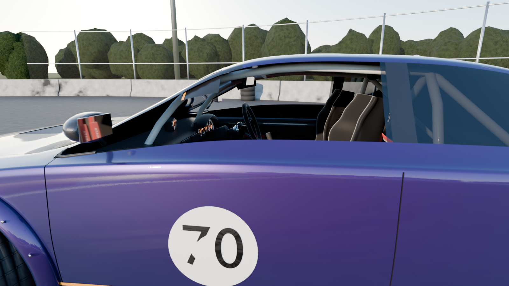
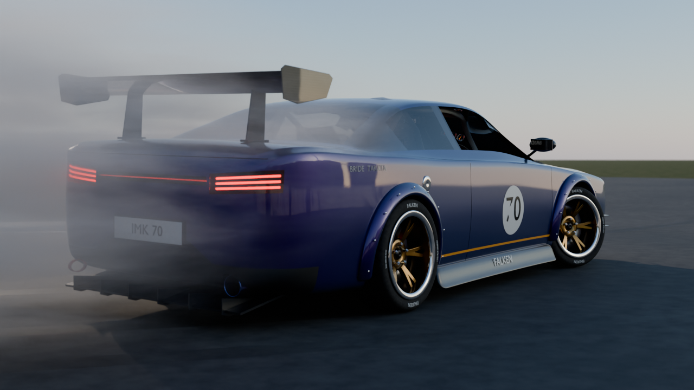
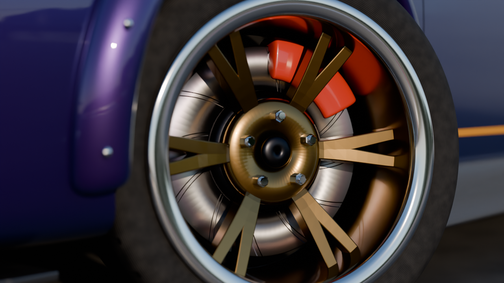

# IMK70 Drift Car (Blender)

A wide-body drift coupe and a full drift scene. All of it is generated by one
Python script (`drift_car.py`), with no downloaded models, textures or HDRIs.



| Cockpit | Seats |
|---|---|
|  |  |

| Through the window | Rear | Wheel detail |
|---|---|---|
|  |  |  |

## Open it

- **Quickest:** open `drift_car.blend` in Blender 4.2 or newer and press **F12**.
- **Rebuild from code:** go to Scripting, open `drift_car.py`, then **Run Script**.
  The scene is rebuilt from scratch in about a minute.
- **Command line:**
  ```bash
  blender -b -P drift_car.py -- --render drift.png --samples 512          # hero shot
  blender -b -P drift_car.py -- --render rear.png --cam rear
  blender -b -P drift_car.py -- --save drift_car.blend                    # just build + save
  blender -b -P drift_car.py -- --render quick.png --samples 64 --percent 50 --no-smoke
  ```
  Cameras: `hero`, `rear`, `side`, `top`, `wheel`, and the interior cameras
  `cockpit`, `seat`, `door`. Interior cameras raise the exposure and turn the
  smoke off automatically. Add `--gpu` to render on a GPU.

## What's modelled

**Body**
- A lofted, subdivided monocoque with creased shoulder lines, tumblehome glass
  and a ducktail boot.
- Real panel gaps: doors, bonnet and boot are cut with exact booleans.
- Bolt-on over-fenders with rivets, carbon side skirts, front splitter, canards
  and a rear diffuser with fins.
- A GT wing: a NACA 6412 inverted aerofoil with a Gurney flap, carbon end
  plates and anodised uprights.
- A louvred bonnet vent, an aero mirror on each side, wipers, a racing fuel
  cap, a burnt-titanium exhaust and tow straps.

**Lights**
- Recessed headlight housings with glass projector lenses, chrome rings and
  L-shaped LED daytime running lights.
- LED-bar tail lights behind red lenses, plus a full-width smoked light bar.
- A honeycomb grille with an intercooler (fins included) behind it, and
  brake-duct grilles.

**Wheels**
- 18" deep-dish rims with 12 split spokes, a polished lip, a 5×114.3 lug-nut
  pattern and a centre cap.
- Directional tyre tread done in the shader, with sidewall ribs and a worn
  look.
- Slotted brake discs with heat discolouration, big front and smaller rear
  calipers with **brembo** logos, camber and counter-steer.
- Raised white **FALKEN AZENIS RT615K+** sidewall lettering, plus the size
  (225/40R18).

**Interior** (right-hand drive; the front windows are wound down so you can see in)
- **BRIDE-style bucket seats:** lofted shells with thigh, side and shoulder
  bolsters and harness slots, in black gradation fabric with red dots that
  fade out up the seat. The brand is embroidered on the headrest and the back
  of the shell. Aluminium side mounts, rails and bolts.
- **TAKATA 6-point harnesses:** shoulder straps run from the harness bar
  through the shoulder slots, plus lap and anti-sub straps, padded shoulder
  pads, adjusters and a cam-lock buckle.
- **MOMO deep-dish wheel:** Alcantara rim with a red 12 o'clock marker and
  stitching, dished spokes, a horn button with the logo and a quick-release
  hub.
- **Instruments:** a leather dash with a suede binnacle. The tacho has 0–9
  numerals and a red line, the speedo reads 0–240, and there are fuel and
  temperature gauges. Each has chrome bezels, glass, backlit faces and
  needles. A triple Defi pod (boost, oil, water) sits on the dash top.
- **Centre stack:** air vents with slats, a carbon switch panel with labelled
  toggles (IGN, FUEL, FAN, WIPER, LIGHT, START), climate knobs and a red kill
  switch.
- **Pedal box:** clutch, brake and throttle with grip strips, plus a dead
  pedal.
- **Floor and controls:** a leather shifter boot, a hydraulic handbrake with
  its reservoir, a fire extinguisher with straps, carpet, rubber mats and a
  transmission tunnel.
- **Cabin trim:** carbon door cards with pull straps, a wide panoramic mirror,
  a rear seat-delete panel, and window seals and door tops.
- **Roll cage:** padded door bars and halo, a harness bar and base plates.

**Materials**
- Multi-layer paint: metallic flakes, clear coat with orange peel, and a
  purple-to-blue pearl flip. The lower valance is textured black.
- Twill carbon fibre, single-surface tinted glass, rubber, brushed and
  polished aluminium.

**Scene**
- Golden-hour sky with a sun lamp.
- Asphalt with aggregate and repair patches, dry grass, and tyre marks that
  follow the drift arc.
- A volumetric tyre-smoke plume, a red/white curb, concrete barriers with
  rubber scuffs, a chain-link catch fence, light towers, a tree line and tyre
  stacks.
- Camera depth of field, and AgX colour management with the Punchy look.

## Customise

Edit the `CONFIG` block at the top of `drift_car.py`:

| key | what it does |
|---|---|
| `paint`, `paint_flip` | body colour and the pearl colour it shifts to at glancing angles |
| `wheel`, `caliper`, `cage` | wheel, caliper and roll-cage colours |
| `livery`, `number`, `plate` | windshield banner, door number, number plate |
| `steer_deg`, `drift_deg`, `turn_radius`, `roll_deg` | drift pose |
| `front_camber`, `rear_camber` | wheel camber |
| `smoke` | tyre smoke on or off (smoke roughly doubles render time) |
| `windows_down` | front side windows down (open) or up (glass) |
| `brands` | brand names on the seats, steering wheel, harness, tyres, calipers, gauges and sponsor decals |

The brands are plain-text wordmarks in Blender's built-in font, not the
official logo artwork. To use real logos, swap in the image files.

## Render times

The included renders were made on a 4-core CPU with denoising on. The hero shot
(1920×1080, 128 samples) took about 25 minutes, and each interior shot
(1600×900, 96 samples) took about 10. A GPU is many times faster.
